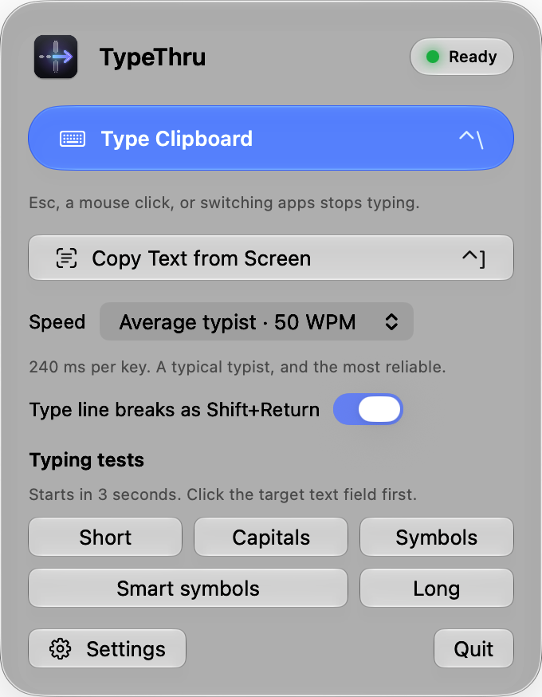

<p align="center">
  <picture>
    <source media="(prefers-color-scheme: dark)" srcset="docs/logo-dark.png">
    
  </picture>
</p>

<h3 align="center">Paste blocked? Type it through.</h3>

<p align="center">
  TypeThru types your clipboard as real key presses into VDI, remote desktops, consoles, and
  websites that block paste. And it copies text back off any screen with one shortcut.
</p>

<p align="center">
  <a href="https://github.com/sayre4ux/TypeThru/releases"></a>
  
  
  <a href="LICENSE"></a>
</p>

<p align="center">
  <a href="https://github.com/sayre4ux/TypeThru/releases"><b>Download for macOS</b></a>
</p>

<p align="center">
  <picture>
    <source media="(prefers-color-scheme: dark)" srcset="docs/panel-dark.png">
    
  </picture>
</p>

## Two shortcuts, both directions

| | Shortcut | What happens |
|---|---|---|
| **Type Clipboard** | **Control+\\** | Copy text on your Mac, click a field anywhere, press the shortcut. TypeThru types it in, key by key. |
| **Copy Text from Screen** | **Control+]** | Drag over any text you can see, even in a remote session, a picture, or a locked-down page. The text lands on your clipboard. |

## Why TypeThru

- **It types, it does not paste.** Remote sessions and web pages that block the clipboard still
  accept a keyboard. TypeThru is that keyboard: a virtual USB keyboard that sends real key
  presses, so even strict VDI clients take them.
- **It gets the details right.** Capitals, symbols, smart quotes, dashes, line breaks, bold and
  italic all arrive as you meant them, at a speed the remote side can keep up with.
- **It stays out of your way.** One shortcut, no window to manage, and it stops the moment you
  press Esc, click, or switch apps.
- **It is private by design.** No keylogging, no cloud. Screen text is read on your Mac, and
  nothing is saved. It is open source, so you can check.

## Features

**Typing in**

- **Real key presses** through a virtual keyboard driver that remote sessions accept.
- **Five speeds**, from an average typist to an unrealistic 600 words per minute.
- **Smart symbols**: bullets, curly quotes, and dashes are typed as plain keys that exist on
  every keyboard.
- **Bold and italic**: Markdown such as `**bold**` and `*italic*` from chat and AI tools
  arrives as real bold and italic in Word, Outlook, and web editors.
- **New lines, not sends**: line breaks are typed as Shift+Return, so chat apps do not send
  half a message. A line break at the end is left out, so a copied command never runs by itself.
- **Stops instantly** when you press Esc, click, or switch apps.

**Copying out**

- **Copy Text from Screen**: select an area, or press Space to pick a window. Apple's on-device
  text recognition reads it, in many languages, and keeps paragraphs and table columns.
- **Nothing leaves your Mac**: the picture is deleted as soon as it is read.

**Everyday**

- **Light and dark**: the panel and Settings follow your Mac's appearance.
- **Your shortcut**: Control+\\ by default, or choose your own.
- **Updates in one click**: TypeThru checks each new version's signature, installs it, and
  keeps its permissions.
- **Lightweight**: about 6 MB, under 50 MB of memory, and no CPU while idle.

## Use cases

- **VDI and remote desktops** where the clipboard is turned off, in either direction.
- **Websites that block copy and paste**: sign-up, bank, and government forms, confirm-email
  and password fields, and web editors that turn paste off. TypeThru types into them like you
  would.
- **Text you can see but not select**: error dialogs, scanned documents, videos, slides,
  images, and pages that block selecting.
- **Virtual machine and server consoles**, before guest tools are installed or through a
  web-based KVM.
- **Apps that block paste**, such as installers and login windows that only accept typing.
- **Long codes**: license keys, recovery keys, and one-time setup codes, typed without a typo.
- **Demos and recordings**: natural, human-speed typing for tutorials and live coding.
- **Accessibility**: send prepared text when typing it by hand is hard.

TypeThru is a tool, and you decide how to use it. Follow the rules of the computers,
sessions, and websites you use it with, including your workplace's IT policy and a site's terms.

## Install

Requires macOS 13 or later, on Apple silicon or Intel.

1. Download the `.dmg` from [Releases](https://github.com/sayre4ux/TypeThru/releases).
2. Drag **TypeThru** into **Applications**, then open it.
3. If macOS says it cannot verify TypeThru, go to **System Settings › Privacy & Security**
   and choose **Open Anyway**. This is needed once.
4. Allow TypeThru in **Accessibility** when asked, and choose whether it opens at login.
5. Choose **Set Up** and enter your password. This installs the virtual keyboard driver,
   which is included in the app.
6. If macOS asks, allow the Karabiner driver in **System Settings**.

No Terminal is needed; everything happens in the app and System Settings. Later versions
install from the panel with one click.

Upgrading to a version with bold and italic? Choose **Set Up** once more to update the helper.

## Use

**Type text in**

1. Copy text on your Mac.
2. Click a text field: in a remote session, a website, or any app.
3. Press **Control+\\** (or your own shortcut).

**Copy text out**

1. Press **Control+]**, or choose **Copy Text from Screen** in the panel.
2. Drag over the text, or press Space and click a window. Esc cancels.
3. Paste it anywhere. The first time, macOS asks to allow **Screen Recording** for TypeThru.

Click the menu bar icon to change the speed or run a typing test. Open **Settings** there to
change the shortcut, open TypeThru at login, or turn features off. Control alone is the safest
shortcut, because other modifier keys also reach the remote session.

**Tips**

- **Formatted text**: choose **Type as is** for **Markdown** in **Settings › Typing** when you
  type code, into a terminal, or into a remote Mac.
- **Spreadsheets**: turn off **Type line breaks as Shift+Return**, because Shift+Return moves
  up a cell there.
- **Slow or busy sessions**: choose a slower speed if characters go missing.
- **Small text**: zoom in before copying from the screen; larger text reads more accurately.

## Troubleshooting

- **Nothing appears:** click the text field first, then try again.
- **Characters are missing:** choose a slower speed.
- **Stars or bold appear where you did not want them:** choose **Type as is** or **Remove the
  marks** for **Markdown** in **Settings › Typing**.
- **Copy Text from Screen does nothing:** allow TypeThru in **System Settings › Privacy &
  Security › Screen & System Audio Recording**, then quit and reopen it.
- **Typing does not start after an update:** turn TypeThru off and on in **Accessibility**.
- **Set Up keeps asking:** allow the Karabiner driver in **System Settings**.

**Diagnostics** in Settings shows what happened on the last run, without any of your text.

## Privacy

- TypeThru sends key presses. It never records what you type.
- No event tap and no Input Monitoring. It only checks whether Esc, the modifier keys, the
  shortcut key, or a mouse button is held down, and while typing, which app and window are in
  front.
- When you change the shortcut, Settings reads only the keys you press in it, until you
  choose one.
- The clipboard is read only when you ask TypeThru to type, and written only when you copy
  text from the screen. Its contents are never saved or logged.
- The screen is captured only when you choose **Copy Text from Screen**, and only the area you
  select. The picture is read on your Mac by Apple's text recognition and deleted right away;
  only the text is kept, on your clipboard. Turn the feature off in **Settings**.
- The only network access is checking GitHub for a new version, at most once a day. The
  request contains only the app name and version; GitHub sees your IP address, as with any
  website. Turn it off in **Settings › Updates**.
- An update is downloaded and installed only when you choose **Install**. TypeThru installs it
  only if it comes from TypeThru's GitHub releases, carries TypeThru's update signature, and is
  signed with the same certificate as the copy you have. Nothing is installed automatically.
- The virtual keyboard helper runs as root because the driver requires it. It accepts key
  presses only from your Mac account and cannot read keyboard input. Besides Shift, the only
  shortcuts it presses are Control+B and Control+I, for bold and italic. Other apps running as
  you could also use it to send key presses, even without Accessibility permission, so
  uninstall TypeThru when you no longer need it.
- Setup and uninstall run as administrator only after you enter your password. First,
  TypeThru checks that its setup files are unchanged since download and that the driver is
  signed by its own developer. Setup never replaces a different driver version.

Report security issues through GitHub private vulnerability reporting.

## Uninstall

Open **Settings** from the panel, choose **Uninstall TypeThru…**, then move the app to the Trash.

## Build from source

```sh
make test && make build
```

Needs the Xcode Command Line Tools. See [AGENTS.md](AGENTS.md) for how it works, signing,
and project rules. Issues and pull requests are welcome.

## License

MIT. The virtual keyboard driver,
[Karabiner-DriverKit-VirtualHIDDevice](https://github.com/pqrs-org/Karabiner-DriverKit-VirtualHIDDevice),
is by pqrs.org under the Unlicense.
